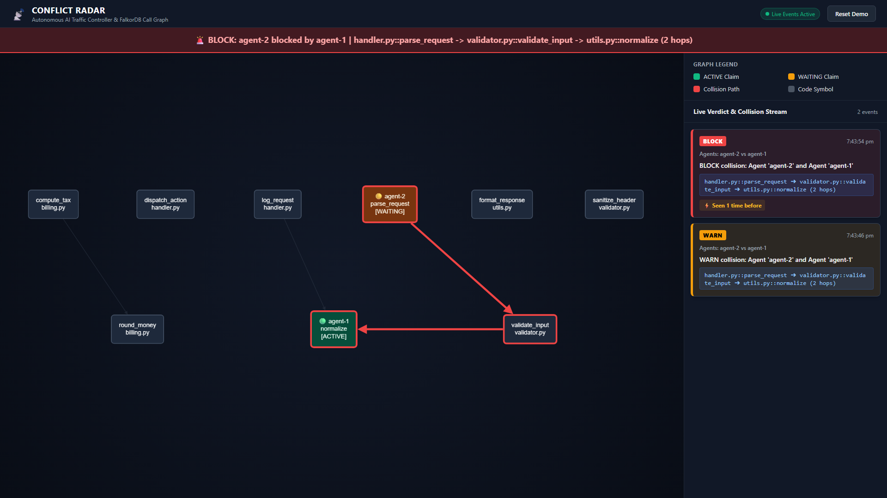
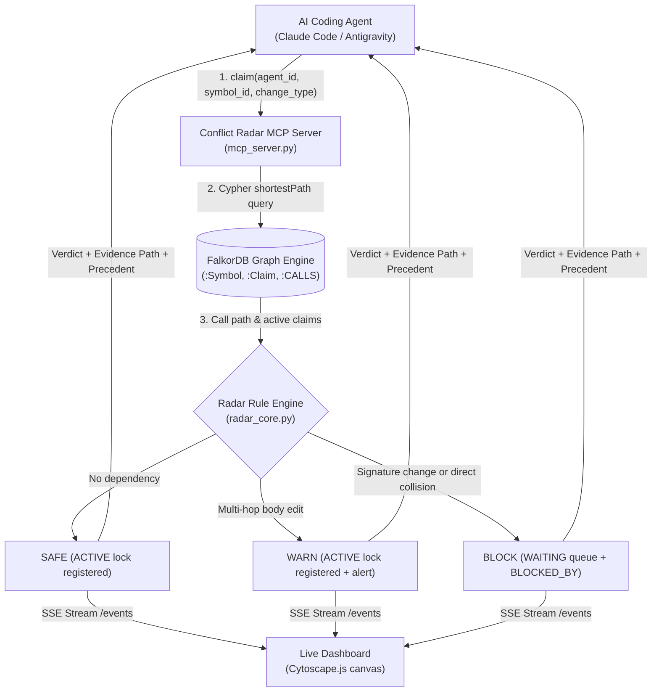
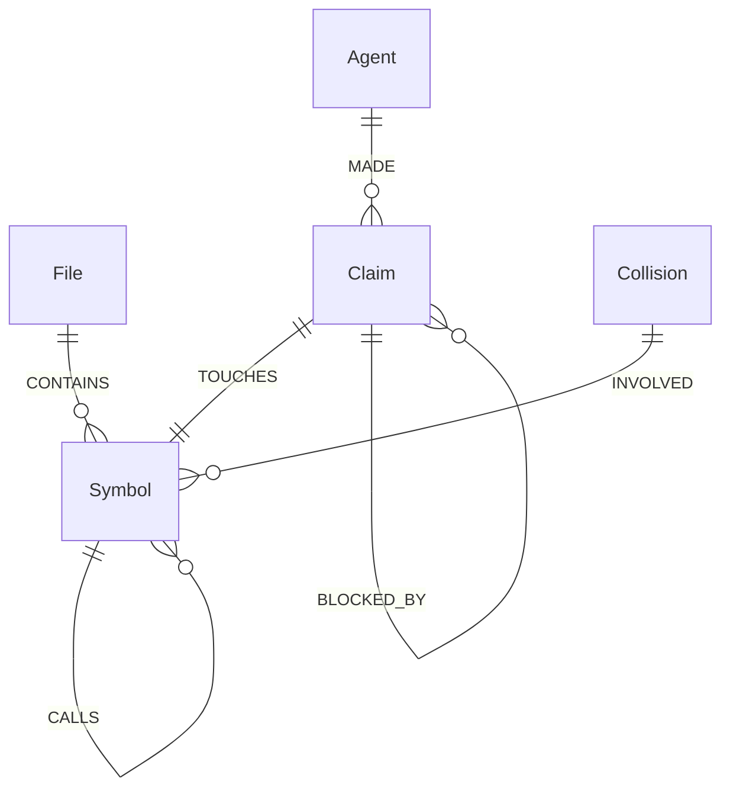

# Conflict Radar 📡
> **Autonomous Multi-Agent Traffic Controller & Semantic Code Graph**
> Built for the *WeMakeDevs x FalkorDB Graph Hacks* (October 2026).

---

## Visual Preview



*Figure 1: Conflict Radar blocking `agent-2` from making a signature change on `parse_request` while `agent-1` is actively editing `normalize` 2 hops away along the call graph.*

---

## 1. The Problem

When multiple autonomous AI coding agents (Claude Code, Antigravity, Cursor, Devin) collaborate on the same repository, they inevitably cause silent build breakage and runtime failures:

1. **Git Conflicts Occur Too Late:** Git detects merge conflicts only post-commit at branch integration time. By the time a merge fails, both agents have already spent minutes or hours writing incompatible code.
2. **File-Level Locks Are Too Coarse:** Locking entire files prevents parallel work even when two agents are editing completely independent functions in the same 1,000-line module.
3. **Transitive Semantic Breaks Are Invisible:** If Agent 1 changes the return type or signature of a utility function (`utils.py::normalize`) while Agent 2 modifies an API controller (`handler.py::parse_request`) that transitively calls it through a validator (`validator.py::validate_input`), Git sees zero merge conflict because the agents edited different files. Yet, at runtime or build time, the entire service crashes.

**Conflict Radar** eliminates this class of multi-agent failures by acting as a real-time pre-commit traffic controller. Before modifying code, agents declare their intent over the Model Context Protocol (MCP). Conflict Radar queries a live FalkorDB call graph, calculates dependency proximity, and returns instant `SAFE`, `WARN`, or `BLOCK` verdicts backed by explicit graph evidence paths.

---

## 2. How Conflict Radar Works



1. **Codebase Indexing:** `indexer.py` traverses Python source files using the standard library `ast` module, creating `(:File)` and `(:Symbol)` nodes, plus `(:CONTAINS)` and directed `(:CALLS)` relationships in FalkorDB.
2. **Intent Declaration:** Before touching an AST node, an agent calls the MCP tool `claim(agent_id, symbol_id, change_type)`.
3. **Bi-Directional Graph Traversal:** Conflict Radar executes an openCypher `shortestPath` query across directed `CALLS` edges in both forward and reverse directions (up to 3 hops) against all actively held claims.
4. **Deterministic Rule Engine:** Based on distance and change types (`BODY`, `SIGNATURE`, `RENAME`), the engine issues a verdict:
   - **`SAFE`:** No conflicting dependency. The agent receives an `ACTIVE` lock and proceeds immediately.
   - **`WARN`:** Transitive dependency with body-only changes. Both agents proceed with an architectural warning.
   - **`BLOCK`:** Incompatible modification (e.g. caller editing signature while callee is being edited). The requesting agent is assigned status `WAITING` with a `[:BLOCKED_BY]` graph edge pointing to the blocking claim.
5. **Cascading Unblock:** When an agent finishes its task and calls `release(claim_id)` (or its lock reaches TTL), the claim transitions to `DONE` (or `EXPIRED`). All waiting claims blocked by it are automatically re-evaluated; if their dependency path is now clear, they are promoted to `ACTIVE`.
6. **Precedent Memory:** Every collision logs a `(:Collision)` node linked via `[:INVOLVED]` edges to both symbols. When the same symbols conflict again, Radar reports historical collision frequency ("Seen N times before").

---

## 3. Graph Data Model

The graph schema models both static code architecture and dynamic agent coordination within the same FalkorDB database instance:



### Node Labels & Properties
- **`(:File)`**
  - `path` *(string, unique)*: Relative repository path (e.g., `validator.py`).
- **`(:Symbol)`**
  - `id` *(string, unique)*: Globally qualified symbol ID (e.g., `validator.py::validate_input`).
  - `name` *(string)*: Identifier name (`validate_input`).
  - `file` *(string)*: Relative file path.
  - `kind` *(string)*: Symbol type (`function` or `class`).
- **`(:Agent)`**
  - `id` *(string, unique)*: Unique agent identifier (`agent-1`, `agent-2`).
  - `name` *(string)*: Human-readable agent label.
- **`(:Claim)`**
  - `id` *(string, unique)*: Auto-generated claim ID (`claim_a1b2c3`).
  - `agent_id` *(string)*: Agent that registered the lock.
  - `symbol_id` *(string)*: Qualified symbol targeted.
  - `change_type` *(string)*: Declared change scope (`BODY`, `SIGNATURE`, `RENAME`).
  - `status` *(string)*: Lifecycle state (`active`, `waiting`, `done`, `expired`).
  - `created_at` *(float)*: Epoch timestamp of creation.
  - `updated_at` *(float)*: Epoch timestamp of last state mutation.
- **`(:Collision)`**
  - `id` *(string, unique)*: Incident identifier (`col_x7y8z9`).
  - `verdict` *(string)*: Severity verdict (`BLOCK` or `WARN`).
  - `path_text` *(string)*: Human-readable call path chain.
  - `agent_a` *(string)*: Requesting agent ID.
  - `agent_b` *(string)*: Existing blocker agent ID.
  - `sym_a` *(string)*: Requesting symbol ID.
  - `sym_b` *(string)*: Blocker symbol ID.
  - `timestamp` *(float)*: Epoch timestamp of collision.

### Relationship Types
- `(:File)-[:CONTAINS]->(:Symbol)`: Associates a source file with its declared functions and classes.
- `(:Symbol)-[:CALLS]->(:Symbol)`: Directed execution invocation from caller to callee.
- `(:Agent)-[:MADE]->(:Claim)`: Provenance link between agent and its lock requests.
- `(:Claim)-[:TOUCHES]->(:Symbol)`: Identifies the exact AST node reserved by a claim.
- `(:Claim)-[:BLOCKED_BY]->(:Claim)`: Explicit dependency edge from a `WAITING` claim to its active blocker.
- `(:Collision)-[:INVOLVED]->(:Symbol)`: Dual incident edges linking a recorded collision to both affected code symbols.

---

## 4. Core Cypher Queries

Below are the 6 core openCypher queries executed by `graph_db.py` against FalkorDB, along with their plain-language explanations:

### Query 1: Bi-Directional Transitive Call Path (`shortestPath`)
```cypher
MATCH (a:Symbol {id: $start_id}), (b:Symbol {id: $end_id})
WITH shortestPath((a)-[:CALLS*1..3]->(b)) AS p
RETURN [node IN nodes(p) | node.id] AS path_nodes
LIMIT 1
```
* **Plain-Language Explanation:** Locates the shortest chain of function calls from symbol `a` to symbol `b` up to 3 hops away. 
* **FalkorDB Specifics:** FalkorDB requires `shortestPath` to be encapsulated inside a `WITH ... AS p` projection before extracting node properties via list comprehension `[node IN nodes(p) | node.id]`. In addition, hop ranges (`*1..3`) must be integer literals in openCypher rather than parameterized values.

### Query 2: Claim Intent Creation (`MERGE` and `CREATE`)
```cypher
MERGE (a:Agent {id: $agent_id, name: $agent_id})
MERGE (s:Symbol {id: $symbol_id})
CREATE (c:Claim {
    id: $claim_id,
    agent_id: $agent_id,
    symbol_id: $symbol_id,
    change_type: $change_type,
    status: $status,
    created_at: $created_at,
    updated_at: $updated_at
})
CREATE (a)-[:MADE]->(c)
CREATE (c)-[:TOUCHES]->(s)
RETURN c
```
* **Plain-Language Explanation:** Idempotently ensures that the `Agent` and target `Symbol` exist in the graph, writes a new `Claim` node with the declared modification intent and status, and connects the claim via `[:MADE]` and `[:TOUCHES]` relationships.

### Query 3: Collision Incident Recording
```cypher
CREATE (col:Collision {
    id: $collision_id,
    verdict: $verdict,
    path_text: $path_text,
    timestamp: $timestamp,
    agent_a: $agent_a,
    agent_b: $agent_b,
    sym_a: $sym_a,
    sym_b: $sym_b
})
WITH col
MATCH (a:Symbol {id: $sym_a}), (b:Symbol {id: $sym_b})
CREATE (col)-[:INVOLVED]->(a)
CREATE (col)-[:INVOLVED]->(b)
RETURN col
```
* **Plain-Language Explanation:** When a `BLOCK` or `WARN` verdict occurs, this query stores a persistent `Collision` node and links it directly to both affected symbols via two `[:INVOLVED]` edges, creating historical memory in the graph.

### Query 4: Historical Precedent Memory Retrieval
```cypher
MATCH (col:Collision)-[:INVOLVED]->(a:Symbol {id: $sym_a})
MATCH (col)-[:INVOLVED]->(b:Symbol {id: $sym_b})
WHERE ($exclude_id IS NULL OR col.id <> $exclude_id)
  AND ($before_time IS NULL OR col.timestamp < $before_time)
RETURN count(col) AS count, max(col.timestamp) AS last_seen
```
* **Plain-Language Explanation:** Looks up how many times these two symbols have collided in the past (strictly prior to `$before_time`, explicitly excluding the current collision ID `$exclude_id` to prevent self-counting). Because it traverses two independent `[:INVOLVED]` edges, the check is completely order-independent: collision between `A` and `B` matches whether queried as `(A, B)` or `(B, A)`.

### Query 5: Lazy Claim Expiry (TTL Cleanup)
```cypher
MATCH (c:Claim)
WHERE c.status IN ['active', 'waiting'] AND c.updated_at < $cutoff
SET c.status = 'expired'
WITH c
OPTIONAL MATCH (c)-[r:BLOCKED_BY]-()
DELETE r
RETURN c.id AS id, c.agent_id AS agent_id, c.symbol_id AS symbol_id, c.change_type AS change_type
```
* **Plain-Language Explanation:** Checks for active or waiting claims whose last update timestamp is older than the configured TTL cutoff. It lazily updates their status to `'expired'`, severs any attached `BLOCKED_BY` relationships, and returns the expired claim IDs so any waiting waiters can be promoted.

### Query 6: Active Claims Retrieval for Collision Evaluation
```cypher
MATCH (c:Claim {status: 'active'})
RETURN c.id AS id, c.agent_id AS agent_id, c.symbol_id AS symbol_id,
       c.change_type AS change_type, c.status AS status, c.created_at AS created_at,
       c.updated_at AS updated_at
```
* **Plain-Language Explanation:** Fetches all currently active locks across the entire codebase. The radar core iterates through active claims and runs `shortestPath` checks to evaluate whether a newly requested claim collides with any concurrent work.

---

## 5. Verdict Rules Matrix

Conflict Radar computes verdicts using graph distance (hops) and declared modification scope:

| Proximity | Existing Lock | Proposed Claim | Verdict | Action Taken | Graph State |
| :--- | :--- | :--- | :--- | :--- | :--- |
| **0 Hops** (Identical Symbol) | Any (`BODY`, `SIGNATURE`, `RENAME`) | Any (`BODY`, `SIGNATURE`, `RENAME`) | **`BLOCK`** | Agent must wait | Claim marked `waiting`, `[:BLOCKED_BY]` added |
| **1 Hop** (Direct Caller/Callee) | Any | `RENAME` or `SIGNATURE` | **`BLOCK`** | Caller/callee interface change | Claim marked `waiting`, `[:BLOCKED_BY]` added |
| **1 Hop** (Direct Caller/Callee) | `RENAME` or `SIGNATURE` | Any | **`BLOCK`** | Active interface refactor | Claim marked `waiting`, `[:BLOCKED_BY]` added |
| **1 Hop** (Direct Caller/Callee) | `BODY` | `BODY` | **`WARN`** | High-risk concurrent edit | Claim marked `active`, alert emitted |
| **2–3 Hops** (Transitive Chain) | Any | `SIGNATURE` or `RENAME` | **`BLOCK`** | Transitive signature break | Claim marked `waiting`, `[:BLOCKED_BY]` added |
| **2–3 Hops** (Transitive Chain) | `SIGNATURE` or `RENAME` | Any | **`BLOCK`** | Transitive signature break | Claim marked `waiting`, `[:BLOCKED_BY]` added |
| **2–3 Hops** (Transitive Chain) | `BODY` | `BODY` | **`WARN`** | Transitive call dependency | Claim marked `active`, alert emitted |
| **> 3 Hops** | Any | Any | **`SAFE`** | Beyond radar horizon | Claim marked `active` |
| **Unconnected** | Any | Any | **`SAFE`** | Independent domains | Claim marked `active` |
| **Same Agent** | Any | Any | **`SAFE`** | Agent modifying own stack | Claim marked `active` (never blocks self) |

---

## 6. Setup from Scratch

### Prerequisites
- Python 3.11+
- Docker & Docker Compose
- Modern web browser (Chrome / Edge / Firefox)

### 1. Clone the Repository & Install Dependencies
```bash
git clone https://github.com/mihulbairagi/conflict-radar.git
cd conflict-radar

# Create and activate virtual environment
python -m venv .venv
# Windows PowerShell:
.\.venv\Scripts\Activate.ps1
# Linux / macOS:
source .venv/bin/activate

# Install pinned dependencies
pip install -r requirements.txt
```

### 2. Start FalkorDB
Launch FalkorDB using the bundled Docker Compose file:
```bash
docker compose up -d
```
Verify the container is listening on port `6379`:
```bash
docker compose ps
```

### 3. Index the Sample Codebase
Index the realistic multi-domain Python sample repository into FalkorDB:
```bash
python indexer.py ./sample_repo
```
*Output will confirm 4 files, 9 symbols, and 4 call edges indexed.*

### 4. Run the Full Test Suite
Verify that all 41 tests pass against the real FalkorDB instance:
```bash
pytest -v -rs
```

### 5. Launch the Visual Dashboard
Start the real-time FastAPI dashboard on port 8000:
```bash
python dashboard.py
```
Open **`http://localhost:8000`** in your browser.

### 6. Run the Interactive Demo
In a separate terminal, launch the interactive CLI demo:
```bash
python demo.py
```
Press `[ENTER]` to step through each scenario while observing live updates in your browser. (To run without pauses, pass `python demo.py --fast`).

---

## 7. Connecting an AI Coding Agent

Conflict Radar speaks standard JSON-RPC over the official Model Context Protocol (MCP). Any MCP-compliant coding assistant can connect directly.

### Claude Code / Cursor / Desktop Configuration
A root [CLAUDE.md](CLAUDE.md) and [.mcp.json](.mcp.json) are provided out-of-the-box:
```json
{
  "mcpServers": {
    "conflict-radar": {
      "command": "python",
      "args": ["mcp_server.py"]
    }
  }
}
```
*Note: If your virtual environment is not globally active on PATH, specify your environment's Python interpreter path (e.g. `.venv/Scripts/python.exe` on Windows or `.venv/bin/python` on Linux/macOS).*

### Live Agent Test Harness
To test a live agent (such as Claude Code) against a background lock in FalkorDB:
```bash
python scripts/test_live_claude.py
```
This acquires a background lock for an upstream peer agent, prompts Claude Code with a breaking change, captures its blocked waiting state, and releases the lock on keypress to observe reactive promotion.

### Documentation & Evaluation Guides
- **Scripted MCP Walkthrough:** [docs/SCRIPTED_MCP_WALKTHROUGH.md](docs/SCRIPTED_MCP_WALKTHROUGH.md) (Step-by-step raw JSON-RPC tool exchange trace).
- **Video Recording Script:** [docs/VIDEO_SCRIPT.md](docs/VIDEO_SCRIPT.md) (3-minute demo script with Hinglish & English tracks).
- **Judge Defense & Q&A Guide:** [docs/JUDGES_DEFENSE_GUIDE.md](docs/JUDGES_DEFENSE_GUIDE.md) (Architectural defense, trade-offs, and FalkorDB technical rationale).

### Available MCP Tools
- **`claim(agent_id: str, symbol_id: str, change_type: str = "BODY") -> dict`**
  Declares intent to edit a symbol. Returns verdict, evidence path, hops, and historical precedent count.
- **`check(claim_id: str) -> dict`**
  Queries current lock status (`ACTIVE`, `WAITING`, `DONE`, `EXPIRED`) and reports the blocking claim ID if waiting.
- **`release(claim_id: str) -> dict`**
  Releases a lock, marking it `DONE`, and cascades promotion across waiting eligible claims.
- **`ping() -> str`**
  Connectivity health check returning `"ok"`.

> 💡 **Scripted Protocol Walkthrough:** See [docs/SCRIPTED_MCP_WALKTHROUGH.md](docs/SCRIPTED_MCP_WALKTHROUGH.md) for a scripted walkthrough demonstrating the complete JSON-RPC request and response payload exchange over stdio (declaring claims, handling `BLOCK`, polling `check()`, and cascade unblocking).

---

## 8. Known Limitations

1. **Static AST Call Resolution:** The current indexer uses Python's standard `ast` module to resolve explicit function and class calls. Dynamic dispatch (`getattr(module, func_name)`) and runtime reflection are not statically resolved.
2. **First Blocker Reporting:** When an agent's proposed edit conflicts with multiple concurrent peers, Conflict Radar reports the first conflicting lock along the shortest path.
3. **Language Scope:** The current AST parser targets Python (`.py`). The FalkorDB graph schema is language-agnostic; indexing JavaScript, TypeScript, or Go simply requires attaching language-specific AST/LSP indexers.

---

## 9. Design Decisions

- **Why a Graph Database over SQL or Key-Value Mutexes?** Traditional file-level mutexes (e.g. Redis locks) are too coarse—they block parallel developers working on independent functions within the same module. Relational databases require slow, recursive CTEs to compute transitive caller hierarchies. FalkorDB computes directional and bidirectional `shortestPath` queries in about 3 ms p95 (3.16 ms on 120+ symbols), providing fine-grained symbol-level locking.
- **Bidirectional Contract Protection:** Code changes don't only affect callees downstream; signature edits break upstream callers. Querying both `(A)-[:CALLS*]->(B)` and `(B)-[:CALLS*]->(A)` guarantees mutual contract safety across any transitive depth.
- **Lazy TTL Expiry:** Background eviction threads risk race conditions when deleting active claims. Instead, Conflict Radar marks stale claims as `expired` lazily during incoming evaluation cycles, keeping locks self-healing and concurrency-safe.
- **Order-Independent Graph Memory:** By linking a single `:Collision` node to two symbols via dual symmetric `[:INVOLVED]` edges, the graph records collision precedent and queries incident frequency regardless of which agent claims first.

---

## 10. AI Use Disclosure

TODO: written by the author.

---

## License
MIT License. Built for the WeMakeDevs x FalkorDB Graph Hacks (2026).
